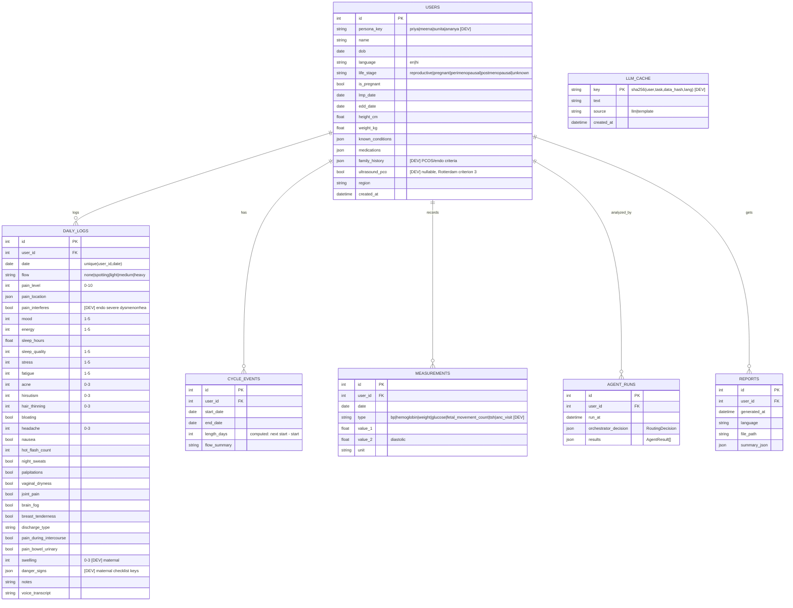

# Sakhi Health: Build Guide

Derived from `docs/brief.md` (source of truth). Deviations are marked **[DEV]** and listed in §11.
Subagents: read only §0–1 plus your own phase row in §5 and the sections it references.

---

## 0. Final stack

| Layer | Choice (installed / pinned) | Why |
|---|---|---|
| Frontend | Next.js 16.4.3 (App Router, `src/`), React 19.3, TypeScript 5 | brief §6 |
| Styling | Tailwind CSS 4, shadcn/ui (`base-nova` style, Base UI primitives), `tw-animate-css`, `next-themes` | dark mode tokens |
| Motion | `motion` 14 (`motion/react`) | all animation; no GSAP (see §8.6) |
| Charts | Recharts 3 + custom SVG/CSS grid for heatmap and gauges | brief §6 |
| Icons / delight | `lucide-react`, `canvas-confetti` (~3 KB) | celebratory moments |
| Backend | Python 3.13, FastAPI, Uvicorn, SQLModel, SQLite, PyYAML, `python-dotenv` | brief §6; 3.13 for wheel availability |
| LLM | `anthropic` SDK, server-side only; model via `ANTHROPIC_MODEL` | brief §11.2 |
| PDF | **[DEV]** `fpdf2` + `uharfbuzz` (text shaping) + Noto Sans Devanagari; charts as matplotlib PNG | ReportLab cannot shape Devanagari conjuncts reliably |
| Tests / lint | pytest, ruff (backend); eslint, `tsc --noEmit` (frontend) | brief §17 |
| Type sync | `openapi-typescript` generates `frontend/src/types/openapi.ts` from FastAPI | no FE/BE drift |
| Design skill | `frontend-design@claude-plugins-official` (project scope, enabled in `.claude/settings.json`) | premium UI |

## 1. Repo tree

```
/                       CLAUDE.md, .gitignore, .env.example
/.claude/agents/        7 subagent specs
/docs/                  brief.md, guide.md
/frontend/              Next.js app (scaffolded, Phase 0 partially done)
  src/app/              (landing)/page.tsx, dashboard/, checkin/, timeline/, heatmap/,
                        agents/[name]/, report/, urgent/, settings/
  src/components/ui/    shadcn primitives (generated; do not hand-edit)
  src/components/viz/   Heatmap, CycleTimeline, RiskGauge, BurdenRadar, TrendBand, GestationBar
  src/components/motion/ RoutingPanel, PersonaTransition, UrgentTakeover, CountUp, Reveal
  src/lib/              api.ts (fetch wrapper), motion.ts (tokens), i18n.ts, utils.ts
  src/types/            api.ts (hand-written, §4), openapi.ts (generated)
  src/messages/         en.json, hi.json
/backend/
  app/main.py           FastAPI app, CORS, router mounts, /api/health
  app/config.py         Settings from env
  app/db.py             engine, get_session
  app/schemas.py        Pydantic API models (§4) — single Python source of truth
  app/api/              personas.py, profile.py, logs.py, measurements.py, timeline.py,
                        analyze.py, report.py, explain.py, user.py
  app/agents/           base.py, orchestrator.py, health_story.py, pcos_endo.py, menopause.py, maternal.py
  app/services/         rules.py, cycles.py, llm.py, prompts.py, guardrails.py, pdf.py, charts.py,
                        navigator.py, i18n.py
  app/models/           tables.py (SQLModel)
  app/seed/             personas.py, generators.py, run.py
  config/clinical_rules.yaml, config/navigator.json
  assets/fonts/         NotoSans-Regular.ttf, NotoSansDevanagari-Regular.ttf (+Bold)
  reports/              generated PDFs (gitignored)
  tests/                test_rules.py, test_orchestrator.py, test_guardrails.py, test_api.py, fixtures/
```

## 2. Setup commands (Windows, Git Bash; PowerShell equivalents in comments)

```bash
# backend (once)
cd backend
py -3.13 -m venv .venv
source .venv/Scripts/activate          # PS: .venv\Scripts\Activate.ps1
pip install fastapi "uvicorn[standard]" sqlmodel pyyaml python-dotenv anthropic fpdf2 uharfbuzz matplotlib pytest httpx ruff
pip freeze > requirements.txt
cp ../.env.example .env                 # then set ANTHROPIC_API_KEY (optional)

# frontend (already scaffolded; fresh clone only)
cd frontend && npm install

# run
cd backend && uvicorn app.main:app --reload --port 8000
cd frontend && npm run dev              # http://localhost:3000, /api/* proxied to :8000
python -m app.seed.run                  # from backend/, resets + seeds all personas

# checks (quiet: failures only)
cd backend && ruff check app tests -q && pytest -q --no-header -x
cd frontend && npm run lint -- --quiet && npx tsc --noEmit && npm run build
npm run gen:types                       # openapi-typescript http://localhost:8000/openapi.json -o src/types/openapi.ts
```

Env vars (`.env.example`, root; backend reads `backend/.env`):

| Var | Default | Use |
|---|---|---|
| `ANTHROPIC_API_KEY` | empty | empty = template fallback mode |
| `ANTHROPIC_MODEL` | `claude-sonnet-5-5` | summaries, questions, Hindi |
| `LLM_TIMEOUT_S` | `8` | then fallback |
| `DATABASE_URL` | `sqlite:///./sakhi.db` | |
| `CORS_ORIGINS` | `http://localhost:3000` | |
| `REPORTS_DIR` | `./reports` | |
| `NEXT_PUBLIC_API_BASE` | empty (uses proxy) | set to Render URL when deployed |

---

## 3. Data model and API

### 3.1 ER diagram



Cycle computation (`services/cycles.py`): a cycle starts on the first `flow in (light,medium,heavy)` day after ≥3 days of `none|spotting`; recomputed for the user on every log write.

### 3.2 API contract (all JSON, prefix `/api`, active user from `uid` cookie)

| Method + path | Request | Response |
|---|---|---|
| GET `/health` | – | `{status:"ok", llm:"live"\|"fallback"}` |
| GET `/personas` | – | `Persona[]` `{key,name,age,life_stage,tagline}` |
| POST `/session/switch` | `{persona_key}` | sets `uid` cookie; `{profile: Profile, analysis: AnalyzeResponse}` |
| GET `/session` **[DEV]** | – | `{profile: Profile}` or 401 |
| GET / PUT `/profile` | PUT: `Partial<Profile>` | `Profile` (PUT re-runs analysis) |
| POST `/logs` | `DailyLogIn` | `{log: DailyLog, analysis: AnalyzeResponse}` (guardrail + orchestrator run) |
| GET `/logs?from&to` | ISO dates | `DailyLog[]` |
| POST `/measurements` | `{date,type,value_1,value_2?,unit}` | `{measurement, analysis: AnalyzeResponse}` |
| GET `/measurements?type` **[DEV]** | – | `Measurement[]` |
| GET `/timeline?days=90` | – | `{cycles: CycleEvent[], days: DayPoint[], markers: Marker[]}` |
| POST `/analyze` | `{lang?}` | `AnalyzeResponse` |
| GET `/agents/{name}` | – | `AgentResult` (latest run) or 404 |
| POST `/report` | `{lang:"en"\|"hi"}` | `{report_id, url:"/api/reports/{id}.pdf", summary}` |
| GET `/reports/{id}.pdf` **[DEV]** | – | `application/pdf` |
| POST `/explain` | `{agent, rule, lang}` | `{text, source:"llm"\|"template"}` |
| DELETE `/user/data` | – | `{deleted:true}`; clears logs/measurements/runs/reports for active user, re-seed via switch |

Errors: always `{error:{code,message}}` with HTTP 4xx/5xx (see §6).

---

## 4. Shared types (canonical; Python `app/schemas.py` ⇄ TS `src/types/api.ts`)

```ts
// frontend/src/types/api.ts
export type AgentName = "health_story" | "pcos_endo" | "menopause" | "maternal";
export type Status = "ok" | "watch" | "flag" | "urgent";
export type Lang = "en" | "hi";

export interface Evidence { rule: string; detail: string; weight: number; }
export interface ChartSpec { id: string; kind: "line" | "bar" | "heatmap" | "gauge" | "radar" | "band"; title_key: string; data: Record<string, unknown>[]; meta?: Record<string, unknown>; }

export interface AgentResult {
  agent: AgentName;
  status: Status;
  score: number;                 // 0..1 normalized
  band?: "low" | "moderate" | "high" | "mild" | "severe";
  headline: string;              // already localized
  evidence: Evidence[];
  suggested_tests: string[];
  specialist: string | null;
  questions_for_doctor: string[];
  charts: ChartSpec[];
  cards?: { key: string; title: string; body: string }[];   // awareness cards [DEV]
  disclaimer_key: "not_a_diagnosis" | "emergency";
  text_source: "llm" | "template";
}

export interface UserContext {   // backend-internal; exported for fixtures/tests
  profile: Profile; age: number; lang: Lang;
  logs: DailyLog[];              // last N=90 days, ascending
  cycles: CycleEvent[]; measurements: Measurement[];
  gestational_week?: number;
}

export interface RoutingDecision {
  activated: AgentName[];        // in activation order (drives panel animation)
  skipped: { agent: AgentName; reason: string }[];
  reasons: Partial<Record<AgentName, string>>;
  urgent: boolean;               // [DEV] short-circuit flag
  urgent_reasons: string[];      // [DEV]
}

export interface AnalyzeResponse {
  run_id: number; ran_at: string;
  routing: RoutingDecision;
  results: AgentResult[];
  summary: { text: string; source: "llm" | "template" };
}
```

```python
# backend/app/schemas.py (same shapes; pydantic v2)
AgentName = Literal["health_story", "pcos_endo", "menopause", "maternal"]
Status = Literal["ok", "watch", "flag", "urgent"]

class Evidence(BaseModel): rule: str; detail: str; weight: float
class RuleResult(BaseModel): fired: bool; evidence: str; weight: float  # rule engine return
class AgentResult(BaseModel): agent: AgentName; status: Status; score: float = 0; band: str | None = None
    headline: str; evidence: list[Evidence] = []; suggested_tests: list[str] = []; specialist: str | None = None
    questions_for_doctor: list[str] = []; charts: list[ChartSpec] = []; cards: list[Card] = []
    disclaimer_key: Literal["not_a_diagnosis", "emergency"] = "not_a_diagnosis"; text_source: Literal["llm","template"] = "template"
class ApplicabilityResult(BaseModel): applies: bool; reason: str; dominance: float = 0
class RoutingDecision(BaseModel): activated: list[AgentName]; skipped: list[Skipped]; reasons: dict[str, str]
    urgent: bool = False; urgent_reasons: list[str] = []
@dataclass(frozen=True) class UserContext: profile: User; age: int; lang: str; logs: list[DailyLog]
    cycles: list[CycleEvent]; measurements: list[Measurement]; gestational_week: int | None
```

Rule: change `schemas.py` first, run `npm run gen:types`, then update `api.ts` if a hand type is affected. `qa-reviewer` diffs both.

---

## 5. Phase checklist (brief §15)

Budget: **S** < 30k tokens, **M** 30–80k, **L** 80–150k (plan mode first). Tier: subagents `sonnet`, QA/docs `haiku`, main session plans L phases.
After every phase: `qa-reviewer` → commit → `docs-scribe` (tick box + phase pointer) → user runs `/clear`.

| # | Phase | Files to create | Owner | Tier | Budget | Acceptance check |
|---|---|---|---|---|---|---|
| [ ] 0 | Setup | root `.gitignore` `.env.example`; `backend/app/{main,config,db}.py`, `requirements.txt`, `ruff.toml`; FE: `next.config.ts` rewrite `/api/:path*`→`:8000`, `src/lib/api.ts`, theme tokens in `globals.css` (§8), fonts in `layout.tsx`, `ThemeProvider`+`TooltipProvider`+`Toaster`, `gen:types` script | backend-core, frontend-ui | sonnet | S | `curl :3000/api/health` → `{"status":"ok"}`; FE home shows it; lint+build pass |
| [ ] 1 | Shared core | `models/tables.py`, `schemas.py`, `services/cycles.py`, `api/{profile,logs,measurements}.py`, `tests/test_api.py` | backend-core | sonnet | M | pytest: POST log → GET returns it; 3 synthetic periods → 2 `cycle_events` with correct `length_days` |
| [x] 2 | Seed + persona switch | `seed/{personas,generators,run}.py`, `api/personas.py`, session switch; FE landing persona cards + `PersonaTransition` | backend-core, frontend-ui | sonnet | M | seed twice → identical row hashes; switching persona changes profile, logs, cycles shown |
| [ ] 3 | Rule engine + interface | `config/clinical_rules.yaml` (cited sources, clinician TODO), `services/rules.py`, `agents/base.py`, `tests/fixtures/*.json` (exported from seed), `tests/test_rules.py` | rules-engine | sonnet | M | `pytest -q` green; every rule has ≥1 fire + ≥1 no-fire test using persona fixtures |
| [ ] 4 | Health Story + viz | `agents/health_story.py`, `api/timeline.py`; FE `viz/Heatmap`, `viz/CycleTimeline`, dashboard stats, skeletons | agents-dev, frontend-ui | sonnet | **L** | Priya: avg cycle ≈48d irregular; heatmap shows acne/hirsutism density; timeline draws 4 long cycles |
| [ ] 5 | Orchestrator + panel | `agents/orchestrator.py`, `api/analyze.py`, `tests/test_orchestrator.py` (snapshot per persona); FE `motion/RoutingPanel` | agents-dev, frontend-ui | sonnet | M | Priya→`[health_story,pcos_endo]`; Meena→`[health_story,menopause]` + pcos skipped w/ reason; Sunita→`[health_story,maternal]`; panel lights up in order |
| [ ] 6 | PCOS/Endo + gauges | `agents/pcos_endo.py`, rules additions + tests, `config/navigator.json`; FE `viz/RiskGauge`, `agents/[name]` page, evidence list, diagnostic-delay card | agents-dev, frontend-ui | sonnet | M | Priya PCOS band ≥ moderate with ≥3 evidence items; each evidence names its rule; gauge counts up |
| [ ] 7 | LLM + guardrails | `services/{llm,prompts,guardrails}.py`, `api/explain.py`, `LLM_CACHE` table, `tests/test_guardrails.py` | llm-pdf | sonnet | M | with key: summary + 5–8 questions; without key: templates, no errors; filter rejects "you have PCOS", "take 500 mg" fixtures; 2nd call served from cache |
| [ ] 8 | PDF (EN) | `services/{pdf,charts}.py`, `api/report.py`, fonts in `assets/fonts`; FE `report/` preview + download | llm-pdf, frontend-ui | sonnet | **L** | `POST /report` for each persona → 1–2 page PDF, all §11.3 sections; **also render one Hindi line now** (risk check) |
| [ ] 9 | Maternal + urgent | `agents/maternal.py`, rules + tests; FE `viz/GestationBar`, `viz/TrendBand` (BP/Hb bands), ANC checklist, `motion/UrgentTakeover`, `/urgent` | agents-dev, frontend-ui | sonnet | M | Sunita seeded: hypertension alert (`flag`); logging BP 162/112 or a danger sign → red takeover with 108/112 |
| [ ] 10 | Menopause + charts | `agents/menopause.py`, rules + tests; FE `viz/BurdenRadar`, hot-flash/night-sweat charts, awareness cards | agents-dev, frontend-ui | sonnet | M | Meena: MRS domains scored, burden moderate/severe, staging hint shown, no hormone-therapy text |
| [ ] 11 | Hindi | `messages/{en,hi}.json`, `lib/i18n.ts`, `services/i18n.py`, LLM `lang` path, Hindi PDF | llm-pdf, frontend-ui | sonnet | M | toggle → all key screens + summary + PDF in Hindi; Devanagari conjuncts render correctly in PDF |
| [ ] 12 | Polish | empty/error states, responsive pass, a11y, reduced-motion audit, settings/delete-data, consent screen, disclaimers, confetti on check-in streak | frontend-ui | sonnet | **L** | 375px viewport no overflow; Lighthouse a11y ≥ 90; reduced-motion disables pulse/sweeps; delete-data works |
| [ ] 13 | Demo prep | `docs/demo.md` script, pre-generated PDFs, deploy config (Vercel + Render), backup video | main + docs-scribe | haiku | S | full 3-min script runs twice offline (no API key) without a glitch |

Every phase also: `qa-reviewer` returns PASS; `docs-scribe` updates this table + CLAUDE.md pointer.

### 5.1 Phase notes (read only your phase)

- **P0**: Next rewrites make FE and API same-origin, so the `uid` cookie works without CORS credentials; still enable CORS for `CORS_ORIGINS` (brief). Scaffold already exists: do not re-run create-next-app or shadcn init.
- **P1**: `UNIQUE(user_id,date)` on daily_logs; POST `/logs` upserts by date. Ages are derived from `dob` vs today.
- **P2**: Seed anchor = today; RNG `random.Random(persona_seed)`; patterns are identical across runs, dates shift. Personas per brief §4/§14; Ananya optional (cut-able). Sunita's final seeded BP = 142/92 (alert, not urgent).
- **P3**: `rules.py` = pure functions `(ctx, cfg) -> RuleResult`, registered by name in a dict; YAML holds thresholds + `source:` per rule. No DB access in rules.
- **P4**: Phase split per brief §10.1: cycle stats, phase-wise symptom frequency, trends, 3 correlations (sleep→next-day mood, pain↔cycle day, stress↔headache; Pearson, report only |r| ≥ 0.3 with n), last-14 vs prev-14 deltas.
- **P5**: Order per brief §9. Menopause dominance beats PCOS when age ≥ 40 unless hyperandrogenism signs present. Urgent check runs first; if urgent, still return Health Story but `routing.urgent=true`.
- **P6**: Score = Σ fired weights / max weight → band low < 0.34 ≤ moderate < 0.67 ≤ high. Always add "exclusions a doctor would check".
- **P7**: Prompts get computed facts JSON only. System prompt bans diagnosis, drug names, doses. Output filter regex list in `guardrails.py`; on reject → template. Load the `claude-api` skill before writing `llm.py`.
- **P8**: fpdf2 `set_text_shaping(True)` with uharfbuzz; matplotlib PNGs for timeline + heatmap.
- **P9**: Danger signs list + thresholds from brief §10.4 in YAML. Urgent bypasses LLM (template text only, instant).
- **P10**: No hormone-therapy recommendation; only "discuss options with a doctor".
- **P11**: Static strings pre-translated; LLM only for dynamic text; fallback templates exist in both languages.

---

## 6. Conventions

| Topic | Rule |
|---|---|
| Python | snake_case; modules ≤ 300 lines; type hints everywhere; ruff default + isort |
| TS | PascalCase components, camelCase fns, kebab-case route folders; server components by default, `"use client"` only for motion/charts/forms |
| API JSON | snake_case keys both sides (no camelCase mapping layer) |
| Agent names | `health_story`, `pcos_endo`, `menopause`, `maternal` everywhere (files, API, i18n keys) |
| i18n keys | `area.item` e.g. `routing.skipped`, `agent.pcos_endo.title`; no hard-coded UI strings after P11 |
| Clinical wording | "patterns commonly associated with…", "consider discussing with a doctor"; never "you have", never drug/dose |
| Errors (BE) | raise `AppError(code, message, status)`; global handler → `{error:{code,message}}`; LLM/PDF failures degrade, never 500 the demo |
| Errors (FE) | `api.ts` throws typed `ApiError`; pages show inline error card + retry; toasts via sonner for writes |
| Env | never commit `.env`; all config via `config.py`; FE only `NEXT_PUBLIC_*` |
| Tests | pytest names `test_<rule>_<fires|silent>`; fixtures from seed, not hand-made |
| Commits | one per phase: `feat(p<N>): <phase name>` (e.g. `feat(p3): rule engine + agent interface`); fixes `fix(p<N>): …` |

## 7. Cut list / never cut

| Cut first → last | Never cut |
|---|---|
| 1. Hindi in PDF (keep UI Hindi) | Health Story + heatmap + timeline |
| 2. Voice input (Web Speech) | Orchestrator routing panel (animated) |
| 3. Ananya persona | Doctor PDF (EN) |
| 4. Menopause depth (keep burden score) | PCOS agent with explainable gauge |
| 5. Maternal depth (keep BP rule + urgent) | One working urgent alert (Sunita) |
| 6. Magic UI extras, confetti | Disclaimers, consent, delete-data |

---

## 8. Design system

Use the `frontend-design` skill for every new page. Target: calm, warm, funded-product feel. Mobile-first (375 → 768 → 1280).

### 8.1 Palette (OKLCH tokens in `globals.css`; Tailwind 4 `@theme inline`)

| Token | Light | Dark | Use |
|---|---|---|---|
| `--background` | `oklch(0.985 0.008 75)` warm cream | `oklch(0.17 0.02 300)` deep aubergine | page |
| `--card` | `oklch(1 0 0)` | `oklch(0.22 0.025 300)` | cards |
| `--foreground` | `oklch(0.24 0.03 300)` | `oklch(0.95 0.01 300)` | text |
| `--muted-foreground` | `oklch(0.50 0.03 300)` | `oklch(0.72 0.02 300)` | secondary text |
| `--primary` | `oklch(0.50 0.17 300)` plum | `oklch(0.72 0.14 300)` | CTAs, active agent |
| `--secondary` | `oklch(0.62 0.10 190)` teal | `oklch(0.74 0.10 190)` | health_story, ok |
| `--accent` | `oklch(0.72 0.14 35)` coral | `oklch(0.76 0.13 35)` | highlights, streaks |
| `--status-ok` | teal `0.62 0.10 170` | `0.74 0.10 170` | ok |
| `--status-watch` | amber `0.80 0.14 80` | `0.82 0.13 80` | watch |
| `--status-flag` | coral `0.66 0.17 35` | `0.72 0.16 35` | flag |
| `--status-urgent` | red `0.58 0.22 27` | `0.64 0.22 27` | urgent only |
| `--heat-0..5` | cream → plum ramp `0.96/0.88/0.78/0.66/0.54/0.42` L, hue 300 | inverted L | heatmap |
| `--agent-*` | health_story teal, pcos_endo plum, menopause coral, maternal rose `0.62 0.16 355` | lighter | agent color coding |

Contrast: text ≥ 4.5:1; never encode status by color alone (icon + label).

### 8.2 Typography (`next/font/google`)

| Role | Font | Size / weight |
|---|---|---|
| Display / headings | **Fraunces** (soft serif, opsz) | 32–48 / 600, tracking −0.02em |
| UI / body | **Plus Jakarta Sans** | 14–16 / 400–600 |
| Numbers | Plus Jakarta Sans `tabular-nums` | stats, gauges |
| Hindi | **Noto Sans Devanagari** (body), **Noto Serif Devanagari** (headings) | +1 step size, line-height 1.6 |

Scale: 12 / 14 / 16 / 18 / 22 / 28 / 36 / 48.

### 8.3 Spacing, radius, elevation

Spacing 4-pt: 4, 8, 12, 16, 24, 32, 48, 64. Radius: chips `9999px`, inputs 12, cards 20, sheets 28. Shadows: soft layered `0 1px 2px oklch(0 0 0/.04), 0 8px 24px oklch(0.5 0.1 300/.08)`; dark mode uses 1px `oklch(1 0 0/.06)` border instead. Touch targets ≥ 44px.

### 8.4 Components

| Component | Spec |
|---|---|
| Card | `rounded-[20px] bg-card p-5`, subtle top-left agent-color glow (radial gradient 8% opacity), hover lift `y:-2` |
| Insight card | status pill + Fraunces headline + 1-line evidence + "Why?" → explain sheet |
| Risk gauge | 240° SVG arc, track `muted`, value arc gradient teal→amber→coral, needle tip dot, center count-up number + band label |
| Burden radar | Recharts Radar, 3 MRS domains + sub-items, fill coral 25% |
| Trend band | Recharts line over shaded threshold bands (normal / alert / urgent) |
| Heatmap | CSS grid (symptoms × 90 days or × cycle day), 10px cells mobile / 14px desktop, `--heat-*` ramp, tooltip per cell |
| Chips / sliders | shadcn ToggleGroup + Slider, emoji-free lucide icons, selected state fills agent color |

### 8.5 Motion rules (`src/lib/motion.ts`)

| Token | Value |
|---|---|
| `dur.fast / base / slow / hero` | 150 / 250 / 400 / 700 ms |
| `ease.out` | `[0.16, 1, 0.3, 1]` (expo-out) |
| `ease.inOut` | `[0.65, 0, 0.35, 1]` |
| `spring.snappy` | `{type:"spring", stiffness:420, damping:30}` (chips, toggles) |
| `spring.soft` | `{stiffness:180, damping:24}` (cards, sheets) |
| `stagger` | 60 ms lists, 90 ms heatmap rows, 350 ms routing agents |

Rules: animate only `transform`/`opacity` (and SVG `pathLength`); enter = fade + 8px rise; exit 70% of enter; no animation > 1.2 s except urgent pulse; `useReducedMotion()` → opacity-only, gauges/counters jump to final, no pulse, no confetti; `MotionConfig reducedMotion="user"` at root.

### 8.6 Signature animations

| # | Animation | Implementation |
|---|---|---|
| 1 | Orchestrator routing panel | hub node → 4 agent nodes; SVG connector `pathLength` 0→1, then node glows in agent color, one by one (350 ms stagger) in `routing.activated` order; skipped agents dim to 40% with reason tooltip slide-in |
| 2 | Heatmap reveal | rows stagger in, cells scale 0.6→1 + opacity with diagonal delay `(row+col)*8ms`, capped 900 ms |
| 3 | Risk gauges | arc `pathLength` sweep 0→score (700 ms expo-out) + `CountUp` number synced via `useSpring` |
| 4 | Cycle timeline | `whileInView` draws cycle bars left→right; flow intensity fills after; pain overlay line `pathLength` on scroll (`useScroll`) |
| 5 | Persona switch | `AnimatePresence mode="wait"`; shared `layoutId` avatar flies from switcher to header; background hue cross-fades to persona tint |
| 6 | Urgent takeover | full-screen `--status-urgent` overlay, scale 1.04→1 + fade 250 ms, concentric ring pulse (1.6 s loop) behind phone icon, large 108/112 buttons, focus trapped, `role="alertdialog"`, haptic `navigator.vibrate` if available |
| 7 | Skeletons + micro | shimmer skeletons matching card shapes; chips spring `scale 0.95` on tap, slider thumb grows 1.15 on drag, check-in submit → checkmark morph + confetti on 7-day streak |

GSAP: **not added**. Motion covers scroll-linked (`useScroll`), SVG path drawing and layout transitions; a second animation runtime adds ~30 KB+ and two mental models.
Optional copy-in components (copy source, no new deps beyond motion): Magic UI `AnimatedBeam` (routing connectors), `NumberTicker`, `BorderBeam` (active agent card), `BlurFade`; Aceternity `Spotlight` (landing hero). Verify their registry/copy command at Phase 12 before use. No 3D libraries.

---

## 9. Testing

Rules: unit per rule (fire + silent). Orchestrator: snapshot per persona (`tests/snapshots/*.json`). Guardrails: forbidden-content fixtures. API: httpx TestClient smoke for every endpoint. FE: `tsc` + lint + build; manual 375px pass. Offline check: unset `ANTHROPIC_API_KEY`, full demo flow.

## 10. Assumptions

1. Team 2–4, 24–36 h, web only, local demo + optional Vercel/Render deploy (brief §19).
2. Single-tenant demo: no auth; active persona held in `uid` cookie.
3. Seed dates are relative to today (deterministic shape, moving dates).
4. Sunita's seeded data ends at a hypertension **alert**; the red urgent screen fires on the live demo entry (BP ≥160/110 or a danger sign), matching demo script step 4.
5. Python 3.13 venv (3.14 is installed but some wheels like `uharfbuzz` may lag).
6. Default LLM `claude-sonnet-5-5`; swap via env if latency matters (cache makes demo calls instant after warm-up).
7. Repo lives under OneDrive: mark the folder "Always keep on this device" or pause sync during installs; `node_modules`, `.venv`, `.next` are gitignored but still synced by OneDrive.
8. Statistics in pitch (endometriosis delay) and India scheme facts stay marked "verify" until a human checks sources.
9. Brief file renamed to `docs/brief.md` to match the path the brief itself specifies.

## 11. Deviations from brief

| # | Deviation | Reason |
|---|---|---|
| D1 | PDF via fpdf2 + uharfbuzz instead of ReportLab/jsPDF | correct Devanagari shaping on Windows wheels |
| D2 | Added `persona_key`, `family_history`, `ultrasound_pco` (users); `pain_interferes`, `swelling`, `danger_signs` (daily_logs); `anc_visit` measurement type; `llm_cache` table | brief agent specs need these inputs; caching required by §11.2 |
| D3 | `RoutingDecision` adds `urgent`, `urgent_reasons`; `AgentResult` adds `band`, `cards`, `text_source` | drive urgent screen, gauges, awareness cards, fallback badge |
| D4 | Extra endpoints: `GET /session`, `GET /measurements`, `GET /reports/{id}.pdf` | FE needs current persona, trend data, PDF download |
| D5 | `POST /logs`, `/measurements`, `PUT /profile` return a fresh `AnalyzeResponse` | brief §9 says orchestrator runs on these events |
| D6 | Frontend scaffolded before Phase 0 (Next 16, shadcn, motion, recharts, lucide, confetti, next-themes) | design tooling requested up front |
| D7 | Next.js rewrite proxy `/api/*` → FastAPI | same-origin cookie, simpler deploy |
| D8 | Sunita urgent fires on live entry, not on seed (Assumption 4) | brief §14 vs §10.4 thresholds conflict (142/92 is an alert, not urgent) |
